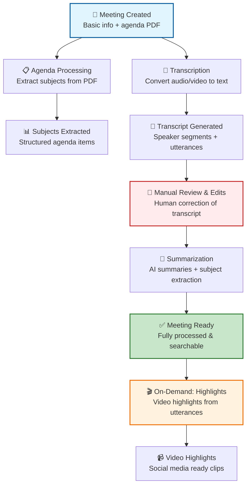
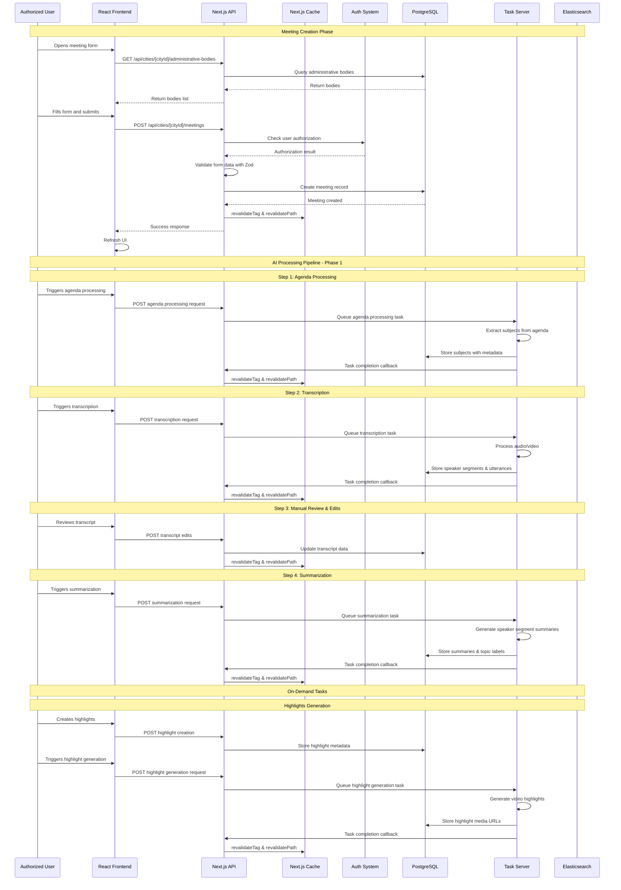

# Meeting Lifecycle & Processing Framework

## Concept

A system for managing the complete lifecycle of council meetings, from the very beginning with the publishing of the agenda to the full digitization of the meeting through our AI processing pipeline, which includes transcription, summarization, agenda processing, highlight generation, and search indexing.

## Architectural Overview

The meeting lifecycle system operates across multiple layers:

1. **Frontend Layer**: React components with form validation using React Hook Form and Zod
2. **API Layer**: Next.js API routes with authentication and authorization checks
3. **Database Layer**: Prisma ORM with PostgreSQL, using composite keys for meetings
4. **Task Processing Layer**: Asynchronous background tasks for AI processing workflows
5. **Status Tracking Layer**: Real-time meeting processing status with stage derivation and UI indicators
6. **Authentication Layer**: Role-based access control with city-level permissions
7. **Search Layer**: Elasticsearch integration for content discovery and search. pgsync replicates the database into the index continuously. There is no search-sync task.
8. **Media Processing Layer**: Video processing for highlights

## Meeting Processing Pipeline Overview

## Meeting Status Tracking System

The system includes comprehensive status tracking that provides real-time visibility into meeting processing progress through multiple stages and task completion states.

### Meeting Stages

Meetings progress through defined stages based on completed tasks. The stages are dynamically derived from the centralized task configuration:

1. **Scheduled** - Initial state when meeting is created
2. **Transcribe** - Audio/video has been transcribed to text
3. **Fix Transcript** - Automatic transcript correction has been applied
4. **Human Review** - Manual review and correction completed by human. A meeting with the verbatim minutes of the municipality (`municipalMinutesUrl`) skips this step. The `fixFromMinutes` task stands in for the review and for the transcript email (`standsInFor` in `TASK_CONFIG`). So the meeting reaches "ready" with no review row. See [Backfill from the municipal minutes](#backfill-from-the-municipal-minutes).
5. **Transcript Sent** - The corrected transcript has been sent
6. **Summarize** - AI summarization and topic extraction completed
7. **Ready** - All required pipeline tasks completed, meeting fully processed

`MEETING_STAGES` in `src/lib/meetingStatus.ts` derives the middle stages from
`CORE_PROCESSING_TASKS`, which holds every `TASK_CONFIG` key with
`requiredForPipeline: true`. Process Agenda is not a stage: it is optional, so
it carries `requiredForPipeline: false`.

The stage derivation logic automatically determines the current stage by checking completed tasks in reverse order, ensuring accurate status representation.

## Schedule Status, Kind and Derived Name

The stages above describe the processing pipeline. The meeting record also holds the facts that the municipality announces. These facts are separate from the stages.

* **Schedule status** (`scheduleStatus`): `scheduled`, `postponed` or `cancelled`, with an optional reason. An admin sets it. The platform does not store "held": a meeting is held when material exists.
* **Kind** (`kind`): `ordinary`, `special`, `accountability`, `activityReport`, `budget`, `presidencyElection` or `financialAccounts`. A null kind means that the record states no single kind. There are two cases. The invitation is not read yet. The record holds several meetings, and its legacy stored name says which. The form offers «Από την πρόσκληση» for null and has no default. Every kind except `ordinary` belongs to a council. `accountability` and `activityReport` take no decisions.
* **Urgency** (`urgent`): the invitation convenes the meeting urgently («Έκτακτη»). Urgency is not a kind. Every body can hold an urgent meeting of any kind. The form shows it as a checkbox, unchecked by default. A later part of a continued meeting has no urgency of its own, as it has no kind and no number.
* **Session number** (`sessionNumber`): the number that the municipality prints. It is not unique. A cancelled meeting keeps its number, and the new meeting after a postponement takes the same number. processAgenda reads it from the invitation; the platform never computes it.
* **Format and place** (`format`, `closedToPublic`, `place`): `format` is null until somebody states it or reads it from the invitation, like the kind. A meeting of unstated format is expected as usual: it can have a stream and a transcript. A meeting without its own `place` shows the `place` of its administrative body. A format that has no place, such as a remote meeting, shows no place. `closedToPublic` is a fact that the meeting page shows to readers. A closed meeting is still recorded and transcribed, and readers get it like any other meeting. To keep the material of a meeting private, an admin unreleases the meeting.
* **Links**: the new meeting after a postponement points to the postponed meeting (`postponedFromId`). A later part of a meeting points to its first part (`continuationOfId`). The continuation has its column and its checks only; the form and the page for it are a follow-up.

The kind, the urgency and the session number come from the Greek Code. They are facts of a city of the `greece` realm only (`recordsGreekCodeFacts`). A write that sets one of them for a city of another realm fails with the rule `greekRealmOnly`. The form does not show the three fields there. The status, the links, the format, the closed flag and the place apply in every realm. A meeting of another realm keeps its stored name. A new meeting there reads as the city's word for "meeting" and the date, for example «Séance 27/04/2026». Support for the rules of another realm comes when that realm needs it.

### The name

The name is derived only. No code path writes `name` or `name_en`: not the admin form, not the API, not the MCP tools. The two columns hold the legacy stored names of the archive. `src/lib/meetingName.ts` derives two forms:

* **The title** (`meetingDisplayName`): the session number, the urgency and the kind, for example «3η Τακτική», «2η Έκτακτη», «4η Ειδική Λογοδοσίας» or «Έκτακτη Ειδική Προϋπολογισμού». A meeting without a number reads «Τακτική Συνεδρίαση» or «Έκτακτη Συνεδρίαση». A meeting of unknown kind ignores its number and its urgency. A meeting of unknown kind reads «Συνεδρίαση 12/03/2026», unless it has a legacy stored name. The title has no body. The meeting page, the cards and the lists use it, because they show the body and the date next to it.
* **The label** (`meetingLabel`): the body, the title and the date, for example «Δημοτικό Συμβούλιο · 3η Τακτική · 12/03/2026». A reader that prints the name on its own uses it. Examples are alerts, emails, the RSS feed, the OG images and the calendar event. Share texts, the MCP tools and the `name` of the public API use it too. The public API also returns the title as `title`.

The legacy fallback has three cases:

* A meeting with a kind uses the derived title and label. Its stored name is ignored.
* A meeting without a kind and with a stored name shows that name as the title and as the whole label, with no body and no date around it, because the name already says them («Δημοτικό Συμβούλιο 11/03/26»). English reads `name_en`, or `name` when `name_en` is empty. A Serbian locale reads the name in its script.
* A meeting without a kind and without a stored name reads «Συνεδρίαση 12/03/2026», and its label is «Δημοτικό Συμβούλιο · Συνεδρίαση 12/03/2026».

The archive backfill fills the facts from the invitations and writes no name: a meeting that gets a kind shows its derived title. A later migration drops the columns, after a check of what each stored name still says that no column holds (see *The archive*).

The kind words exist in Greek and English. The other locales name a meeting by their word for "meeting" and the date. The date is in the timezone of the city.

The kind words, the ordinals, the title rule and the legacy fallback live in the shared module `packages/ui/src/lib/meeting-title.ts`. `meetingName.ts` adds the date in the timezone of the city and the Serbian script. The shared module declares the kinds without Prisma, and `meetingName.ts` asserts that the list equals `MeetingKind`, so a new kind does not compile until it has words.

Notis does not receive a title. The view `notis_meeting_events` gives the facts: `meetingName` holds the legacy stored name (null when there is none), and `meetingKind` and `sessionNumber` follow. Notis derives the title from these facts with the shared module, with the same legacy fallback. Its agent prompt states the title and the raw facts, and the admin pages show «body · title · date». An event or a ledger row from before this change has only the stored name, and Notis shows that name. The Elasticsearch field `meeting_name` still reads the column, and no query reads that field.

### From the invitation

processAgenda (task version 7) reads the meetings of the agenda and their subjects in one call. It returns `meetingRecord`, the kind, the urgency, the session number and the format of this meeting as the invitation states them, each with the phrase it was read from, and `meetingsInAgenda`, every meeting the agenda calls with how many of the subjects are its own. The number is the one printed with «Συνεδρίαση», never the invitation number («Αριθμός Πρόσκλησης», «41η ΠΡΟΣΚΛΗΣΗ»). This meeting is the one of its body, and among two of one body the one at its time: the request carries the body and the start in the city's time.

`applyAgendaMeetingRecord` in `src/lib/tasks/applyAgendaMeetingRecord.ts` applies it through the lifecycle rules, before the notifications, because the kind is part of the derived name, and syncs the calendar event when the derived title changes. It never writes a name. Nothing is overwritten; what needs a person goes to the admins as one Discord alert:

* A value the meeting lacks (a null kind, number or format) is filled. The kinds follow the table of #150. A kind that this version of the platform does not know is reported, not written.
* The urgency is filled when the invitation says urgent. `urgent` defaults to false, so false is no statement: an urgency that the meeting holds and the invitation does not state is reported, never unset.
* A value the meeting holds is compared. A meeting made with an agenda leaves the kind and the format to the invitation.
* A council-only kind read for another body is reported, not written, because the rules refuse it.
* A kind replaces a stored name with the derived title. A stored name that says more than that title («Δημοτική - Διαχειριστική Επιτροπή», «[Διεκόπη]») keeps showing: the kind is reported, not written, until a person decides.
* An agenda that holds more than one meeting (a λογοδοσία at 19:00 and a regular meeting at 20:00, or a council and a committee invitation in one file) is reported. A record holds one meeting, so every subject of the agenda is saved on this one; an admin decides whether the others need their own records. When several of the meetings are this body's and no other record holds them, the record is a combined meeting: it keeps no kind, no urgency and no number until it is split, and shows its stored name or «Συνεδρίαση <date>». One that it already holds is reported. processAgenda marks the meetings of this body (`ofThisBody`, by `sameBody` in opencouncil-tasks). A record of the same meeting does not hold the other one: the meeting it was postponed from or to, a later part, a postponed or cancelled record (`holdsAnotherMeeting`). A record with no body counts as the council's.
* An agenda that names another city of the platform is refused before anything is saved: the task fails with the reason. Only that positive evidence refuses. A municipality that is no city of ours (a typo such as «Ευροστίνης»), a body other than this meeting's (often the reader taking the hall, «αίθουσα Δημοτικού Συμβουλίου», for the body), and a different date or time are reported, and the agenda is saved.

Only a Greek city is checked and filled (`recordsGreekCodeFacts`): the record follows the Greek Code, and the identity check compares names as Greek text. On the 651 agendas of the archive it refuses none.

The rules of the comparison live in `src/lib/agendaMeetingRecord.ts`, which the archive backfill shares.

### The write path and the visibility rules

`src/lib/meetingWrites.ts` is the one write path for the details of a meeting. The meeting API routes and the MCP admin tools (`create_meeting`, `update_meeting`) call it after they authorize the request. It calls `src/lib/db/meetingLifecycle.ts`, which runs the rules of `src/lib/meetingLifecycleRules.ts` and the write in one transaction. The release toggle and the delete function call the lifecycle module directly.

* A link goes to a postponed meeting of the same body, with no cycle. The status of a postponed meeting cannot change while its new meeting exists.
* The link alone changes no visibility. When the admin releases the new meeting, every public meeting before it in the chain becomes unreleased. Each of those meetings remembers it (`hiddenByPostponement`). Then the admin can unrelease or delete the released new meeting. The postponed meeting before it is released again only when that release had hidden it. A postponed draft stays a draft.
* A postponed meeting has one new meeting at most.
* A change of status never changes the visibility. A postponed meeting stays public until its new meeting is released. A cancelled meeting stays public.
* No public payload carries `postponedFromId` or `continuationOfId`. The new meeting shows the date for which it was first scheduled (`postponedFromDate`).
* The write takes no lock. Two admins who edit the same postponement chain at the same moment can, in theory, break the rules above.

### What the other parts of the platform do

* **Public presentation**: `publicMeetingPresentation` in `src/lib/meetingPresentation.ts` shows a postponed or cancelled meeting as such at every age, in place of its stage. A meeting held by circulation offers no channel before it starts, and its strip says that the decisions come after the written vote. After it starts, it reads as held without a recording. Its transcript tab and its subject statements say why they are empty, and no row or subject promises a debate that is still to come (`presentationPendingKind` returns null). The page of a `beforeMeeting` notification promises no video.
* **One meaning for each value**: `src/lib/meetingLifecycleRules.ts` holds a table for each enum (`SCHEDULE_STATUSES`, `MEETING_FORMATS`, `MEETING_KINDS`). Code reads `takesPlace`, `TAKES_PLACE_WHERE`, `hasPublicRecording` or `PUBLIC_RECORDING_WHERE`, never a raw value. A new value fails to compile until each table gives it a meaning.
* **Pipelines and lists**: some parts skip a meeting that does not take place. These are the livestream cron, the decision poller, the bulk poll dialog and the upload lists. The landing page, the city rail, the embed widget and `/latest` skip it too. `requestTranscribeInternal` refuses it, and also a meeting held by circulation. A pending notice before a postponed or cancelled meeting is not sent.
* **Calendar**: `syncMeetingToCalendar` patches the event of a postponed or cancelled meeting to `status: 'cancelled'`. It patches the event back to `confirmed` only when the meeting returns to scheduled. Any other edit leaves the status alone. A past meeting emails nobody.
* **Decision polling** skips the meetings that take no decisions, λογοδοσία and απολογισμός, by `kind`, not by the name. A later part takes the kind of its first part. The migration set the kind of the existing λογοδοσία meetings.

### The archive

The migration sets `kind = accountability` on the existing λογοδοσία meetings of a council, because the decision poller reads the kind. The other facts of an archive meeting stay null, and the meeting shows its stored name until it has a kind. A λογοδοσία meeting that the migration gave a kind shows the derived title at once, and its stored name is ignored.

The archive takes the same reading of its invitations, without a re-run of processAgenda: a re-run would replace the subjects of meetings that summarize has already processed. The backfill writes facts only: the status, the kind, the urgency, the session number, the format, and the link from a postponed meeting's new meeting. It writes no name. The scripts read `DATABASE_URL`; the dev shell loads `.env` over a value set before `nix develop`, so export it inside the shell to target another database. A meeting that gets a kind shows its derived title, and its stored name stays in the column, unread.

1. `npx tsx scripts/meeting-record-export.ts --out reports/meeting-record-export.json` lists the meetings of Greek cities with an agenda. `--supported --per-body 4` takes a sample to measure first.
2. In opencouncil-tasks, `npm run cli -- read-meeting-records reports/meeting-record-export.json -O reports/meeting-records.json` reads the meetings of each agenda, without its subjects, with the same rules as processAgenda. A second run reads only what is missing or failed.
3. `npx tsx scripts/meeting-lifecycle-report.ts --records reports/meeting-records.json --out reports/meeting-lifecycle.csv` writes the proposals. The invitation fills a missing value, and a difference from a held value lands in `invitationDiffers`. The name is the fallback for a kind or an urgency when the invitation is not read. The format of an archive meeting holds the default, not a choice, so the invitation fills it too, by circulation included. The report runs the callback's identity check: an agenda it would refuse proposes nothing. A name that says the meeting did not take place («Ακυρώθηκε», «Ματαιώθηκε», «Δεν πραγματοποιήθηκε», «Αναβολή»), or an invitation that postpones it, proposes a status, and a status the record holds is kept. The next meeting of the same body tells a postponement from a cancellation: the new meeting after a postponement keeps the number, or its invitation says «από αναβολή». `proposedPostponedTo` names it. `review` is empty for a row with nothing to look at. It names, among others, a combined meeting, a meeting with decisions that the proposed kind would take out of the decision poll, a kind from the name that the body cannot hold, and a stored name that says more than the derived title (`storedNameLoses`), which the kind would stop showing. Leave such a row without `yes` to keep its name.
4. Review the CSV. Write `yes` in the `apply` column of each row to apply.
5. Run `npx tsx --require ./scripts/lib/allow-server-only.cjs scripts/meeting-lifecycle-apply.ts --csv reports/meeting-lifecycle.csv` for a dry run, then with `--apply`. It first checks every accepted row: a value the CSV cannot hold, or a held kind, number or urgency that the row would replace, stops it with nothing written. It skips a row that changed since the report, writes an audit file, and syncs the calendar event when the title changes. A postponed meeting gets its status and its new meeting's link in one transaction, through the rules of the form; when the new meeting is public, the link unreleases the postponed one, as a release would.
6. Run `npx tsx --require ./scripts/lib/allow-server-only.cjs scripts/meeting-lifecycle-verify.ts --audit <audit file>`. It prints the counts and fails on what would need a rollback: a council-only kind on another body, a kind, an urgency or a number on a later part or outside Greece, a council record named λογοδοσία that holds another kind, a meeting with decisions that the decision poll now skips, and a link that the apply wrote and is missing. It prints the postponed meetings with and without a new meeting.
7. To undo, run the apply script with `--rollback <audit file>` (a dry run without `--apply`). It restores each applied row, newest first, only while the row still holds what the apply wrote; a row changed since is listed and left as it is. It removes a link before it restores the status, which shows a postponed meeting again when the link had hidden it.

Before a later migration drops `name` and `name_en`, `storedNameLoses` of a fresh report lists the names that still say something no column holds («[Διεκόπη]», a name of two meetings). Each is moved into the facts or accepted as lost first.

## Sequence Diagram

## Key Component Pointers

*   **Data Models**:
    *   `CouncilMeeting`: `prisma/schema.prisma` (composite key: cityId + id, relations to city, administrativeBody, subjects, highlights, taskStatuses)
    *   `City`: `prisma/schema.prisma` (meetings array, administrative bodies, timezone support)
    *   `AdministrativeBody`: `prisma/schema.prisma` (optional meeting relation, types: council/committee/community)
    *   `TaskStatus`: `prisma/schema.prisma` (task execution tracking with type, status, request/response bodies)
*   **API Endpoints**:
    *   `src/app/api/cities/[cityId]/meetings/route.ts` (POST: create, GET: list meetings)
    *   `src/app/api/cities/[cityId]/meetings/[meetingId]/route.ts` (GET: fetch, PUT: update meeting)
    *   `src/app/api/cities/[cityId]/meetings/[meetingId]/status/route.ts` (GET: meeting processing status and stage)
    *   `src/app/api/cities/[cityId]/meetings/[meetingId]/taskStatuses/[taskStatusId]/route.ts` (POST: task callbacks)
    *   `src/app/api/cities/[cityId]/administrative-bodies/route.ts` (GET: list administrative bodies)
*   **Database Functions**:
    *   `src/lib/db/meetings.ts` (getCouncilMeetingsForCity, toggleMeetingRelease)
    *   `src/lib/meetingWrites.ts` (createMeetingWithEffects, updateMeetingWithEffects: the writes of the API routes and the MCP admin tools)
    *   `src/lib/db/meetingLifecycle.ts` (createMeetingRecord, updateMeetingRecord, setMeetingReleased, deleteMeetingRecord, originalScheduledDate)
    *   `src/lib/db/tasks.ts` (getMeetingTaskStatus, MeetingTaskStatus type, task completion tracking)
*   **Frontend Components**:
    *   `src/components/meetings/AddMeetingForm.tsx` (dual-purpose create/edit with Zod validation)
    *   `src/components/cities/CityMeetings.tsx` (meetings list with filtering and editing integration)
    *   `src/components/meetings/admin/Admin.tsx` (task management, release controls, cache tools)
    *   `src/components/meetings/CouncilMeetingWrapper.tsx` (meeting data context provider)
    *   `src/components/meetings/MeetingStatusBadge.tsx` (visual status indicator with stage-based styling)
    *   `src/components/meetings/MeetingTimeline.tsx` (detailed processing timeline with task completion status)
    *   `src/components/admin/meetings/ExpandableMeetingRow.tsx` (enhanced meeting row with status display and timeline)
*   **Authentication**:
    *   `src/lib/auth.ts` (withUserAuthorizedToEdit, isUserAuthorizedToEdit, hierarchical permissions)
*   **Task Processing Pipeline**:
    *   **Core Pipeline**: Process Agenda (optional) → Transcribe → Fix Transcript → Human Review → Summarize. With the municipal minutes: Transcribe → Fix Transcript → Fix From Minutes → Summarize, with no step for a person.
    *   **Post-Processing**: Highlight Generation, Voiceprint Generation, Decision Polling
*   **Cache Management**:
    *   `src/lib/cache/queries.ts` (cache invalidation via Next.js API routes)
    *   `src/lib/cache/index.ts` (createCache utility with performance logging)
    *   Cached queries: `getMeetingDataCached()`, `getCouncilMeetingsPreviewCached()`, `getCityCached()`, `getMeetingStatusCached()`
*   **Context Providers**:
    *   `src/components/meetings/CouncilMeetingDataContext.tsx` (central data provider with speaker management)
    *   `src/components/meetings/VideoProvider.tsx` (video playback state and seeking operations)

## Business Rules & Assumptions

### Authorization Rules
1. Only users with city administration rights can create/edit meetings
2. Superadmins can edit any meeting in any city
3. Users can edit meetings if they administer the city directly or through party/person relationships
4. Unreleased meetings are only visible to authorized users

### Data Validation Rules
1. A request carries no name. The API and the MCP tools drop a `name` or `name_en` that a client sends, because the name is derived
2. Meeting ID is auto-generated from the date when the form sends none, with `_2`, `_3` for a second meeting on one day. An admin can type an ID
3. The kind and the format may stay unstated («Από την πρόσκληση»). The lifecycle rules in `src/lib/meetingLifecycleRules.ts` apply to every write
4. YouTube and agenda URLs must be valid URLs or empty strings
5. Administrative body selection is optional but validated if provided
6. Date/time combination must be valid and not in the distant past

### Status Tracking Rules
1. Meeting stage is dynamically derived from completed tasks
2. A meeting is considered "ready" only when all required pipeline tasks are completed
3. Stage derivation checks tasks in reverse order to find the latest completed stage
4. Status updates are cached and automatically invalidated when tasks complete
5. See [`docs/task-architecture.md`](/docs/task-architecture.md) for detailed task configuration and management

### Workflow Assumptions
1. Meetings are created in "unreleased" state by default
2. Meeting ID follows pattern: `month_day_year` (e.g., `jan_15_2024`)
3. Administrative bodies must exist in the same city as the meeting
4. Form supports both creation and editing modes through props
5. Cache invalidation happens automatically after successful operations
6. Status tracking provides real-time visibility into meeting processing progress
7. Human review can be manually marked as complete via admin interface

## Backfill from the municipal minutes

Some municipalities keep verbatim minutes (πρακτικά). With the recording and the minutes, an operator can backfill a past meeting with no reviewer (#876). The task server corrects the transcript from the minutes. It also names the speakers from the labels of the minutes. `opencouncil-tasks/docs/minutes-correction.md` describes how.

* **The document.** `CouncilMeeting.municipalMinutesUrl` holds the minutes of the municipality, a PDF or a DOCX. The meeting form has a field for it. The admin MCP takes it on `create_meeting`, `update_meeting` and `start_task`. `create_document_upload_url` uploads a file that has no public URL. The name keeps the field apart from `src/lib/minutes/`, which generates minutes from our data.
* **Who sees the URL.** A municipality can give us minutes that it does not publish. So the URL is for the administrators of the meeting only. `hideLinks` removes it from every public payload. The editor list keeps it only on the meetings that the caller edits. The edit form reads the stored value from the editor list. The form sends the field only when the administrator changes it.
* **The chain.** When `fixTranscript` succeeds on a meeting with minutes, its handler starts `fixFromMinutes`. When `fixFromMinutes` succeeds, its handler starts `summarize`, as the end of a review does. `fixFromMinutes` does not run at the same time as `transcribe`, `fixTranscript` or `summarize`. A later run of `transcribe`, `fixTranscript` or `fixFromMinutes` supersedes an earlier correction result.
* **A refused start.** A `summarize` that runs when `fixTranscript` finishes makes the automatic start of `fixFromMinutes` fail. Nothing retries a refused start. So the `summarize` handler checks the meeting when the summary ends. If no correction started on the corrected transcript, it starts `fixFromMinutes`.
* **No review.** `TASK_CONFIG.fixFromMinutes.standsInFor` names `humanReview` and `transcriptSent`. `getMeetingTaskStatus` reads a required step as done when the step or a stand-in succeeded. The stage and the "ready" flag follow from that. The public transcript gate reads `REVIEWED_TRANSCRIPT_TASK_TYPES`, which holds the review and its stand-in. No review row is written. So the reviews table and the review stats count no review.
* **No voiceprints.** A name that no voice supports needs a human review before its audio becomes a voiceprint. Such a name comes from the transcript or the minutes alone, or from their agreement without the voiceprint. A `fixFromMinutes` run does not count as that review. So a backfilled meeting feeds no voiceprint until a person reviews it.
* **No notifications.** One news rule decides every notification (`notificationOutcome`, `@opencouncil/ui/lib/meeting-news`). A meeting older than `STALE_MEETING_MS` (15 days) is never news. An agenda processed after the meeting is not sent. A draft notifies nobody until its release. So a backfilled meeting notifies nobody.
* **The record.** Every task edit records its run in `UtteranceEdit.taskId`. So the changes of `fixTranscript` and of `fixFromMinutes` stay apart. `list_transcript_edits` lists the edits of a run. Each edit shows the page and the speaker label of the turn it came from. `revert_transcript_edit` puts the earlier text back as an edit of the caller. A correction never overwrites the text of a person, a revert included.
* **The report.** The result of a run carries a report: coverage, corrections, contested speakers, disagreements between methods and unresolved labels. `get_meeting` shows it on the newest successful run.
* **The roster.** The task names speakers from the roles in force on the meeting date. The roles of a past term must be in the city before the backfill. Otherwise the labels of the minutes resolve to nobody, and the report lists them.
* **Speakers.** The minutes are a third `SpeakerIdentification` method, `minutes`, beside `voiceprint` and `transcript`. The editing interface guide describes how the three combine.
