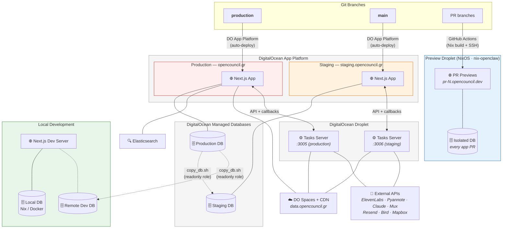

# Infrastructure & Deployment

How OpenCouncil's environments, databases, and services are connected.

## Deployment Topology



> **Diagram legend:** Solid lines (──) are runtime connections. Dashed lines (╌╌) are manual/scripted data flows. Arrows with labels show deployment mechanisms.

## Environments

| Environment | URL | Branch | Database | Tasks Server |
|-------------|-----|--------|----------|-------------|
| **Production** | opencouncil.gr | `production` | Production DB (DO Managed PostgreSQL) | `:3005` |
| **Staging** | staging.opencouncil.gr | `main` | Staging DB (DO Managed PostgreSQL) | `:3006` (tasks.opencouncil.gr) |
| **PR Previews** | pr-N.opencouncil.dev | PR branch | Staging DB (shared), or isolated DB for migration PRs | — |
| **Local** | localhost:3000 | any | Local (Nix/Docker) or Remote Dev DB | — |

## How Deployments Work

**Production & Staging** are deployed via [DigitalOcean App Platform](https://www.digitalocean.com/products/app-platform). Both environments are configured to auto-deploy when their respective branches are pushed — `production` for opencouncil.gr, `main` for staging.opencouncil.gr. No CI/CD workflow in this repo; App Platform handles the build and deploy.

**PR Previews** are deployed to a NixOS droplet managed by [nix-openclaw](https://github.com/schemalabz/nix-openclaw), via GitHub Actions workflows in this repo (`.github/workflows/preview-deploy.yml` and `preview-cleanup.yml`). The workflow builds the app with Nix, pushes to Cachix, then SSHs into the droplet to create the preview. Every app preview gets a PostgreSQL cluster on the droplet. The packaged seed command loads the verified subset from [opencouncil-seed-data](https://github.com/schemalabz/opencouncil-seed-data/releases). Preview startup always uses its generated local database URL. See [guides/preview-deployments.md](./guides/preview-deployments.md) for the full setup.

**Tasks Server** (opencouncil-tasks) runs on a DigitalOcean droplet — both the production (`:3005`) and staging (`:3006`) instances run on the same machine. Deployed manually via SSH from the opencouncil-tasks repo.

### Preview Task Linking

PR previews can be linked to an opencouncil-tasks preview for end-to-end testing. Add this HTML comment to your PR body:

```
<!-- preview-link: tasks=<TASKS_PR_NUMBER> -->
```

When the preview is created, the `opencouncil-preview-create` script detects this and configures the preview's `TASK_API_URL` to point to the linked tasks preview instead of the shared staging tasks server. This allows testing changes across both repos in isolation.

## Logs

- **PostHog Logs** (production and staging): `npm run production:start` starts Next with `node --require ./telemetry.cjs`. It sends two kinds of record to the project that `NEXT_PUBLIC_POSTHOG_PROJECT_TOKEN` names, the same project as the browser's events. The variable must be set at run time, not only at build time:
  - one record for each console call, with its level;
  - one record for each request, except a successful `/api/health` check: the method, the path, the route (`http.route`, for example `/[locale]/[cityId]/[meetingId]`), the status, the duration, the user agent, and the client address.

  The route comes from Next's built-in OpenTelemetry tracing. Next turns it on because `telemetry.cjs` registers a tracer globally. Its own spans, about 20 per request, are not exported; `telemetry.cjs` reads only the route that Next writes onto the request span.

  Every record also carries the container (`service.instance.id`) and the build's commit (`service.version`, from `NEXT_PUBLIC_BUILD_COMMIT_SHA`).

  The client address comes from App Platform's `do-connecting-ip` header. A request without it, which did not pass the App Platform edge, gets the address of the socket's peer, never the first `X-Forwarded-For` entry. A request that the client aborts, or that fails before it has a status, is a `warn` record with `aborted: true` and no status. The console lines of a request share its trace id and its span id.

  `telemetry.cjs` keeps each request to PostHog under its 2 MB limit: a batch has at most `MAX_BATCH_RECORDS` records, a record body is cut to `MAX_BODY_BYTES` once JSON-escaped, and an attribute value to `MAX_ATTRIBUTE_CHARS` characters. Both PostHog projects keep logs for 90 days, which is the retention that the privacy policy states for server logs. This is a custom retention in the Logs settings of each project. The default is 14 days.
- **stdout**: the same console lines, and two short `[request]` lines for each request, without the client address. The first line comes when the request starts, the second when it ends. Both carry the request's span id, for example `[request] cf4f9f1b32e0faad start GET /el`. A request that stalls the server has only the first line. App Platform keeps the last output of a crashed instance (`doctl apps logs <app> opencouncil --type run_restarted`). To find the request in PostHog, filter `span_id` on the full id; PostHog does not match a part of it.
- **Better Stack**: production stdout, through the App Platform log destination of the `opencouncil` service.
- **Paths**: request records and lines take the path from the request line, remove the query string, and redact credentials in the path (`/mcp/mcp_…`, `/api/join/…`). `src/lib/utils/logSafePath.cjs` holds the one list for `telemetry.cjs` and for the app.
- **Personal data**: nothing masks log output. The code keeps personal data out of log lines where they start:
  - `createPrismaClient` rewrites Prisma errors without the arguments of the call.
  - `executeElasticsearchWithRetry` removes the query from Elasticsearch errors.
  - A lint rule (`consolePersonalDataSelectors` in `eslint.config.mjs`) checks console calls, in `.cjs` files too.
  - `tests/integration/log-personal-data.test.ts` runs the app's paths with canary values.

  Two PostHog settings find a line that still leaks:
  - Project settings → Logs → **Scrub PII in Logs at ingestion** is on. PostHog replaces email addresses, bearer tokens, and the values of attributes such as `email` or `token` with `{{REDACTED}}`. It does not find phone numbers, names or addresses.
  - A log alert, **Personal data in logs**, fires on one matching record in 60 minutes. Its filter is Message matches regex `\{\{REDACTED\}\}|\+[1-9][0-9]{9,14}|(^|[^0-9])69[0-9]{8}([^0-9]|$)`, which is the scrubbing marker, an international phone number, or a Greek mobile number. PostHog cannot send it to Discord, so `/dpo-check` reads its history each month.

  When the alert fires, fix the log line in the code. The same line is also in Better Stack, which does not scrub.
- **What the logs miss**:
  - PR previews (`node server.js`) and Docker (`npx next start`) do not load `telemetry.cjs`.
  - A request that Node itself refuses, for example a request line with raw non-ASCII characters, gets a 400 before any code runs. It leaves no record and no line.
  - A SIGTERM before Next has registered its own handler stops the process without a flush. Every later exit waits up to 2 s for the last records.
  - An uncaught exception ends the process without `process.exit`, so its last records do not reach PostHog. Its stack is in stdout. `telemetry.cjs` adds no handler of its own, so that it does not change how Next handles the exception.
  - When PostHog is slow, the exporter keeps at most 2,048 records in memory and drops the rest without a message. stdout still has them.

## Application Architecture

Two repositories, connected via callbacks:

| Repository | Role | Stack |
|------------|------|-------|
| **opencouncil** (this repo) | Web app, API, database schema | Next.js, Prisma, PostgreSQL + PostGIS |
| **opencouncil-tasks** | Heavy processing (transcription, AI, media) | Express, Node.js |

The app queues a task in the database and sends a request to the tasks server. The tasks server does the work (calling external APIs) and POSTs results back to the app via a callback URL. See [task-architecture.md](./task-architecture.md) for details. For the full meeting processing pipeline, see [guides/meeting-lifecycle.md](./guides/meeting-lifecycle.md).

## File Storage

The app stores the files that people upload in the `townhalls-gr` Spaces bucket: agendas, recordings, decisions that are not on Diavgeia, logos and images. The preview server's environment also names `townhalls-gr`, so a test upload on a preview writes to the production bucket.

A meeting file (an agenda, a recording or a decision) goes from the client straight to the bucket, with URLs that the app signs:
- `UPLOAD_KINDS` in `src/types/upload.ts` lists the kinds, the formats that the task server reads for each, and their size limits. An agenda is a PDF or a .docx of at most 20 MiB. A decision is a PDF of at most 20 MiB. A recording is a video (.mp4, .mov or .mkv) or an audio file (.mp3, .wav, .m4a or .aac) of at most 40 GiB.
- `startUpload()` in `src/lib/uploads.ts` names the file `uploads/{cityId}_{body}_{meeting}_{kind}_{random}.{ext}` and signs the upload. A file of at most 1 GiB goes up in one PUT. The PUT sends `x-amz-acl: public-read`, which makes the file public. A bigger file goes up in parts of 1 GiB, and `completeUpload()` joins them after the client sends every part. Each signed URL binds the size of its file or part, so the bucket refuses a PUT of another size (403).
- The browser calls `POST /api/upload/start` and `POST /api/upload/complete` from the link-or-file field. An MCP client calls `create_upload_url` and `complete_upload`.

The browser sends its PUTs to the bucket from the page's origin, so the bucket's CORS rules must allow that origin. On 2026-10-29 the rules of `townhalls-gr` allowed `https://opencouncil.gr`, `https://staging.opencouncil.gr`, `https://opencouncil.rs`, `https://opencouncil.fr` and `http://localhost:3000`. A browser upload from a preview or from the domain of another realm fails until its origin is added. The `opencouncil-previews` bucket has no CORS rules, so a browser cannot upload to it.

A multipart upload that a client starts and never completes keeps its parts in the bucket, and they are billed. A lifecycle rule with `AbortIncompleteMultipartUpload` on the bucket removes them.

`uploadFile()` in `src/lib/s3.ts` stores logos and images that the server receives in a form. It names each file with a random UUID.

## Backups

DigitalOcean backs up the whole database cluster, with point-in-time recovery. SnapShooter also dumps the `production` and `notis-production` databases to the `opencouncil-db-backups` Spaces bucket. To restore those dumps locally and check that they work, use the [`test-backup`](../.claude/skills/test-backup/SKILL.md) skill.

The Notis job connects as the read-only role `notis_backup`. DigitalOcean does not store its password, so a password reset in the DigitalOcean panel stops the job until SnapShooter has the new password.

## Known Limitations

**Search runs against a single production Elasticsearch index.** Staging points at that same index read-only; since the staging database is hydrated from production, the index approximately matches it, and search drops hits that don't resolve against the database — so data edited on staging does not appear in staging search results. Previews and local development have no search. Setup, drift semantics, and what staging does not cover: [elasticsearch/README.md](../elasticsearch/README.md#staging).
